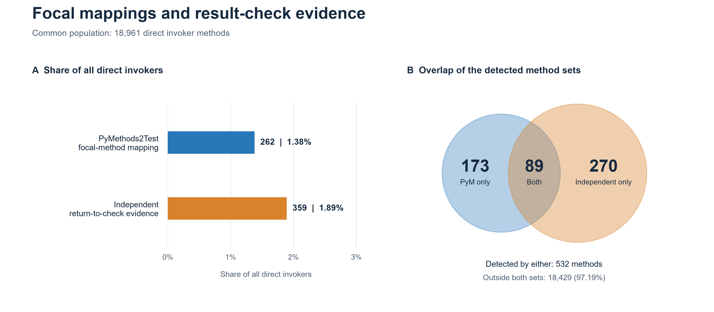

# Findings — one question, one figure, one table

**Historical figures under review for the correctness-guardrail study (2026-11-03).**
See `METHODOLOGY_REVIEW.md` section J. These figures do not measure validated guardrail
prevalence. F2 is generation configuration; F4/F5 need a production-method baseline.
The saved images have not been regenerated during this review.

Observed population: **644 applications** in which a framework LLM call site was detected. Raw provider-SDK calls are excluded.

Regenerate with `py -3.14 Applications/make_figures.py`.

## F1. Do these applications use an LLM evaluation framework?

**38 of 644 (5.9%) call one. ragas and deepeval account for 37 of them; giskard and phoenix appear in none.**

Table: [`F1_eval_adoption.csv`](figures/F1_eval_adoption.csv)

## F2. Do LLM calls set the parameters that control non-determinism?

**23,814 of 24,077 call sites (98.9%) set none of the eight. The most often set is `top_k` (152 call sites, 44 of them passed as a variable); `seed` is set at no call site.**

Table: [`F2_determinism_parameters.csv`](figures/F2_determinism_parameters.csv)

## F3. Which frameworks do these applications actually call?

**langchain leads at 60% of 644 applications. Measured from detected call sites, not from the search token, so a framework is credited only where it is actually invoked.**

Table: [`F3_frameworks_called.csv`](figures/F3_frameworks_called.csv)

## F4. Is the code that calls the LLM ever what a test is written against?

**558 tests in 110 applications (0.05% of the 1,217,210 identified) are written against a method that calls an LLM; 36 of those call the model in their own body as well. From the other side, 296 of 23,990 framework call sites (1.2%) sit inside such a method.**

Table: [`F4_focal_mapping.csv`](figures/F4_focal_mapping.csv)

## F6. How do focal-method mappings compare with independent result-check evidence?

**Over the same 18,961 direct invoker methods, PyMethods2Test identifies 262 focal-method mappings (1.38%); the independent analysis finds 359 return-to-check candidates (1.89%). The sets share 89 methods: 173 appear only in the focal mappings and 270 only in the independent set.**

[Editable SVG](F6_method_mapping_comparison/invoker-method-comparison.svg) · [Rates](F6_method_mapping_comparison/rates.csv) · [Overlap](F6_method_mapping_comparison/overlap.csv)

[Caption and interpretation notes](F6_method_mapping_comparison/CAPTION.md) · [Input/output provenance](F6_method_mapping_comparison/manifest.json)

Reproduce F6 from the saved inputs with [build_figure.py](F6_method_mapping_comparison/build_figure.py), supplying a fresh output directory. Added 2026-11-04; prior figures are preserved.
