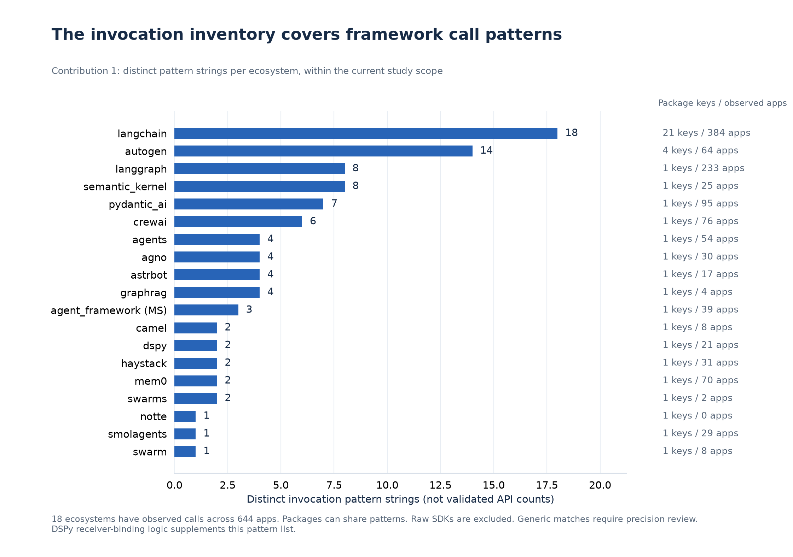
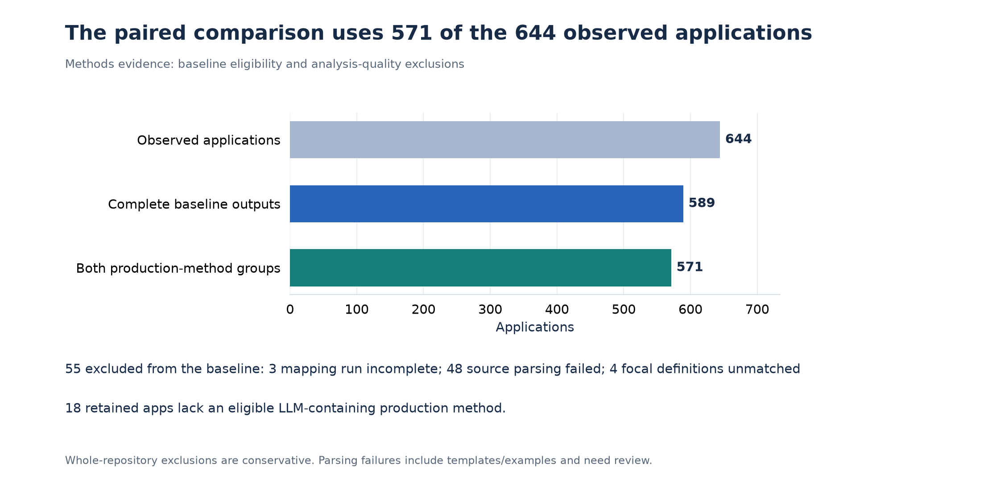
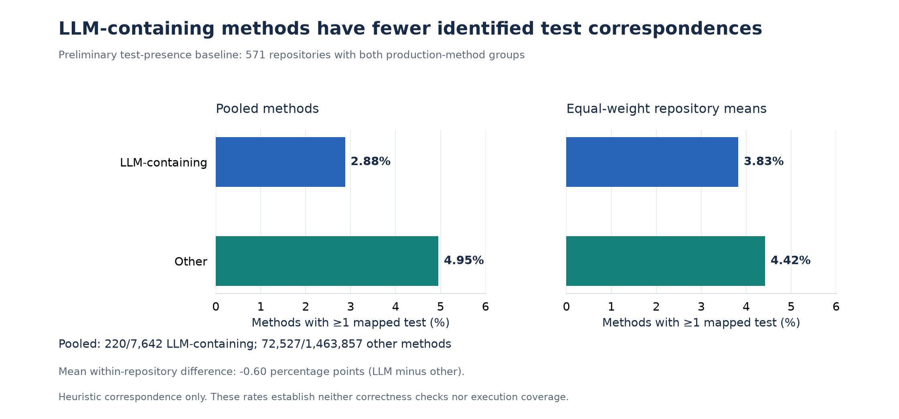
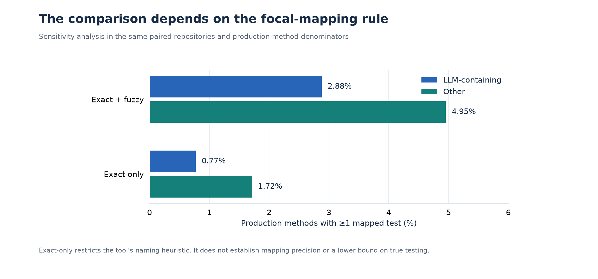
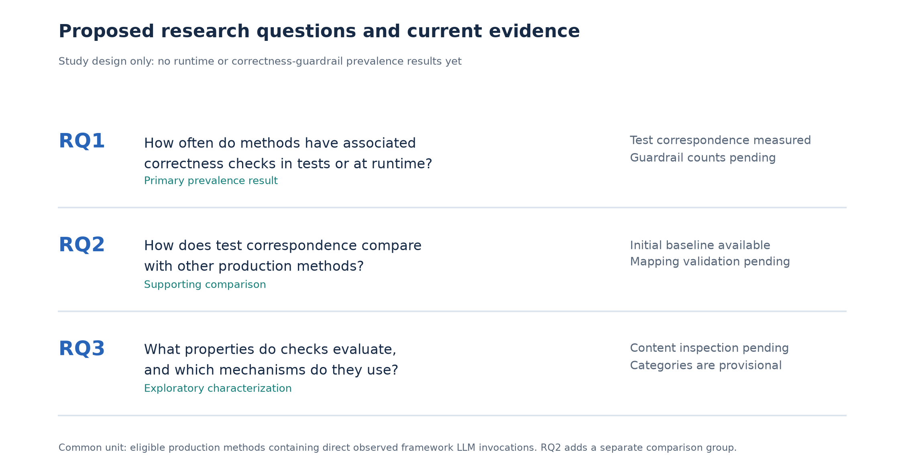
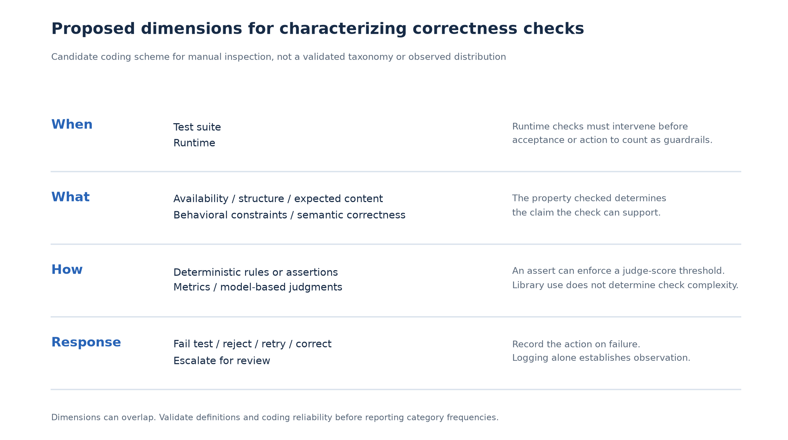

# Guardrail study figures

New figures from saved evidence. Historical figures are unchanged.
G1–G4 summarize existing evidence. G5–G6 are explicitly proposed, not findings.
See manifest.json for input hashes, versions, statuses and captions.

## G1_invocation_inventory

**What invocation patterns does the inventory cover?**

Status: Existing inventory; precision/completeness validation ongoing

Read directly from source literals and the documented LangChain-alias and bare-name filters, without executing the registry. Patterns are neither independent APIs nor evidence of guardrails. Full entries are in invocation_inventory.csv.

## G2_baseline_eligibility

**Which applications contribute to the method comparison?**

Status: Measured; exclusions under review

Complete-case analysis. Repository exclusion is not evidence of missing tests. Pairing requires both method groups.

## G3_test_correspondence

**How often do LLM-containing production methods have a corresponding test?**

Status: Measured correspondence; precision/exclusion review pending

Both panels use method-based rates in the same paired repositories. Equal-weight means average each repository's rate. The comparison is descriptive and does not establish a causal or statistically significant gap.

## G4_mapping_sensitivity

**How sensitive are correspondence rates to fuzzy matching?**

Status: Measured diagnostic

All identified tests are eligible. Exact-only means at least one exact naming-rule match, not a manually validated test.

## G5_proposed_research_questions

**Which questions can the current evidence answer?**

Status: PROPOSED study design, not empirical results

The inventory and reproducible pipeline support all questions. Guardrail overlap (test only/runtime only/both) needs common method denominators and a separate unassessed category. Proposed RQ wording remains open for discussion.

## G6_candidate_check_dimensions

**What might distinguish kinds of correctness checks?**

Status: PROPOSED categories, not observed findings

These dimensions separate checked properties from implementation mechanisms. Simple versus complex assert is not a mutually exclusive taxonomy. Examples are illustrative and have not been identified in the corpus by this figure builder.
